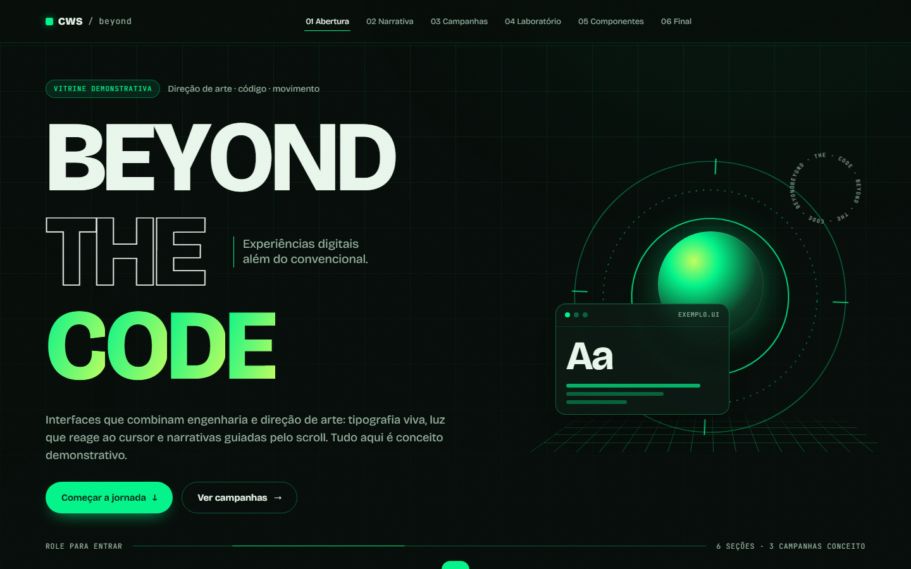
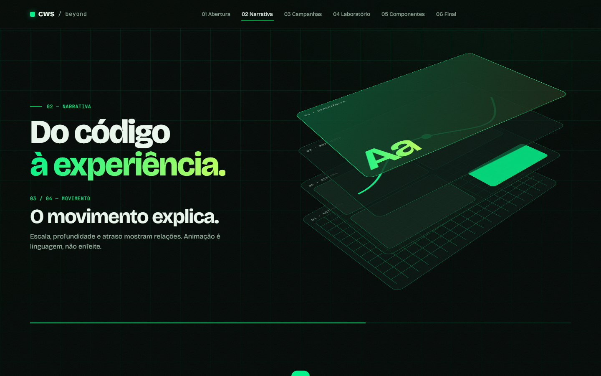
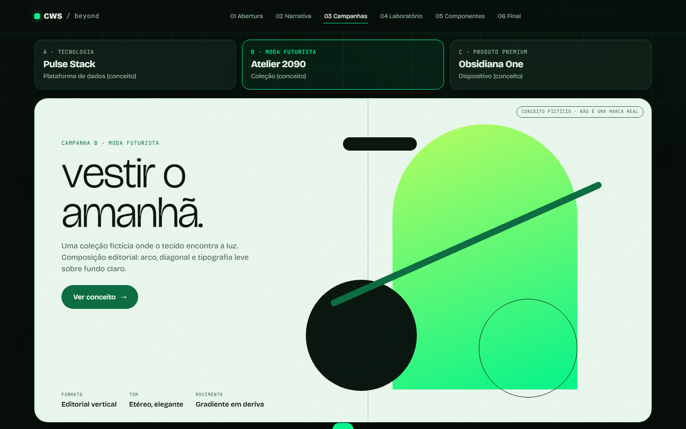
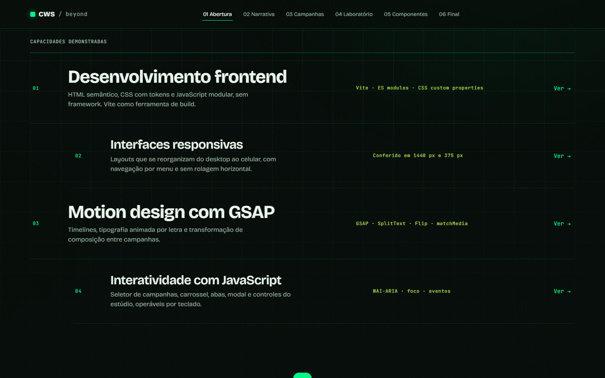
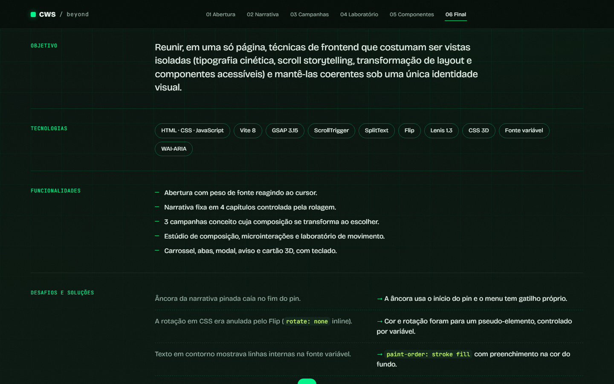
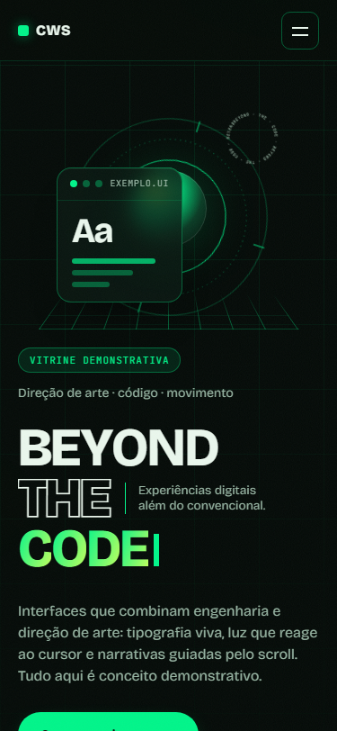
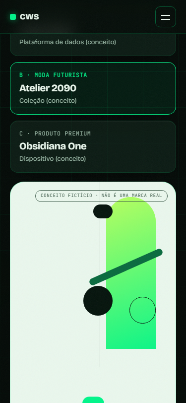

# Beyond the Code — Creative Web Showcase

Projeto experimental de desenvolvimento **frontend** que reúne, em uma só página, tipografia cinética, scroll storytelling em 3D, campanhas interativas e componentes acessíveis, sob uma identidade visual única (**Cyber Tech Premium**: preto-esverdeado, verde neon e lima).

> **Todo o conteúdo é demonstrativo.** Nomes, produtos e textos são fictícios. Não há clientes, depoimentos nem resultados reais.



## Capturas de tela

| | |
|---|---|
|  **Narrativa por scroll:** cena 3D fixa em 4 capítulos |  **Campanhas:** a composição se transforma ao escolher |
|  **Capacidades demonstradas** |  **Estudo de caso técnico** |
|  **Mobile (375 px)** |  **Campanha no mobile** |

Todas as capturas (desktop 1440×900 e mobile 375×812) estão em [`portfolio/capturas`](portfolio/capturas). Não há gravação em vídeo (veja [Limitações](#limitações-e-pendências)).

## Funcionalidades

1. **Abertura** — "BEYOND THE CODE" com tipografia cinética: o peso de cada letra (fonte variável) reage ao cursor; entrada com SplitText; parallax e grade iluminada pelo cursor.
2. **Narrativa** — storytelling pinado em 4 capítulos (Estrutura, Sistema, Movimento, Experiência); a rolagem controla escala, profundidade, posição e opacidade de 4 camadas 3D.
3. **Campanhas** — 3 conceitos fictícios (tecnologia, moda futurista, produto premium). Ao escolher um, layout, tipografia e formas se transformam de verdade (GSAP Flip + SplitText). Funciona por teclado (setas).
4. **Laboratório** — estúdio de composição (peso, espaçamento, luz, layout), microinterações e laboratório de movimento (marquee, parallax, texto, hovers, reveal).
5. **Componentes** — carrossel, cartão 3D, abas WAI-ARIA, modal nativo e avisos.
6. **Encerramento** — estudo de caso técnico, autoria e fechamento.

Além disso: iluminação dinâmica por variáveis CSS, scroll suave com Lenis integrado ao ScrollTrigger, menu com seção ativa e layout responsivo.

## Tecnologias

| Tecnologia | Uso |
|---|---|
| HTML, CSS, JavaScript (ES modules) | base do projeto, sem framework |
| [Vite](https://vite.dev) 8 | servidor de desenvolvimento e build |
| [GSAP](https://gsap.com) 3.15 (ScrollTrigger, SplitText, Flip) | animações, scroll e transformação de layout |
| [Lenis](https://lenis.darkroom.engineering) 1.3 | scroll suave |
| CSS 3D, `@property`, fonte variável | profundidade, temas animados, tipografia |
| Bricolage Grotesque e JetBrains Mono (Google Fonts) | tipografia |

## Como executar

Requer **Node.js 18+** (testado com Node 24).

```bash
npm install
npm run dev        # desenvolvimento: http://localhost:5173
npm run build      # build de produção em /dist
npm run preview    # serve o build localmente
```

## Estrutura

```
index.html          marcação semântica
src/main.js         ponto de entrada
src/style.css       identidade, layout, componentes, iluminação, responsivo
src/motion.js       SplitText, entrada do hero, reveal, parallax, menu ativo
src/kinetic.js      peso tipográfico reativo no hero
src/story.js        narrativa pinada (scroll storytelling)
src/campaigns.js    campanhas conceito (Flip)
src/lighting.js     sistema de iluminação
src/scroll.js       Lenis + ScrollTrigger (âncoras, pin, modal)
src/components.js   carrossel, modal, cartão 3D, abas, menu, estúdio
portfolio/          capturas de tela e documentos de apresentação
```

## Acessibilidade

HTML semântico, link para pular conteúdo, foco visível, navegação por teclado (setas no seletor de campanhas, abas e carrossel), `<dialog>` nativo e região `role="status"` para anunciar a campanha escolhida. Com `prefers-reduced-motion`: sem scroll suave, sem pin, sem tipografia cinética e troca de campanha instantânea.

## Participação da IA no desenvolvimento

Este projeto foi desenvolvido **com assistência de IA** (Claude, da Anthropic), e a divisão de papéis foi:

- **Direção criativa — humana.** Briefing, identidade visual, escolha do que entra em cada versão (V1 a V4 e o refinamento de apresentação) e aprovação.
- **Implementação assistida — IA.** O código (HTML, CSS, JavaScript) foi escrito pela IA a partir da direção criativa, consultando documentação e skills oficiais do GSAP.
- **Validação — IA e humana.** A IA executou build e testes no navegador durante o desenvolvimento; a revisão visual e a aprovação final são humanas.

A autoria é identificada provisoriamente como **Desenvolvedor Web em Formação**.

## Limitações e pendências

- Movimento reduzido testado só por **simulação**; falta testar a preferência real do sistema.
- Sem teste em **toque físico**, com **leitor de tela** ou da navegação completa por Tab.
- **Desempenho** não medido em hardware modesto (a cinética limita-se a ~40 fps e pausa fora da tela).
- Sem fotografias: as imagens são composições em CSS e SVG.
- Fontes via Google Fonts (offline usa fonte alternativa).
- Sem gravação em vídeo das funcionalidades.
- Sem licença de uso definida: o `package.json` marca `UNLICENSED` até que o autor escolha uma.

## Documentação adicional

- [`portfolio/DESAFIOS_TECNICOS.md`](portfolio/DESAFIOS_TECNICOS.md) — três desafios técnicos e como foram resolvidos.
- [`portfolio/README.md`](portfolio/README.md) — índice dos materiais de portfólio.
